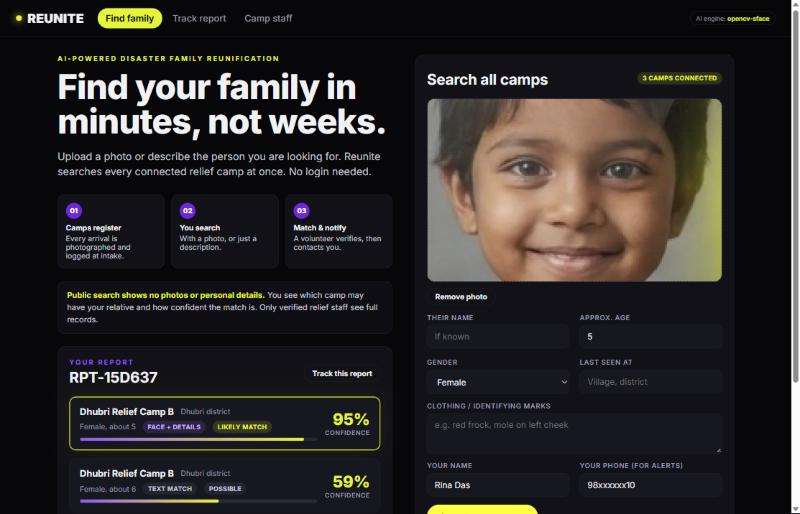
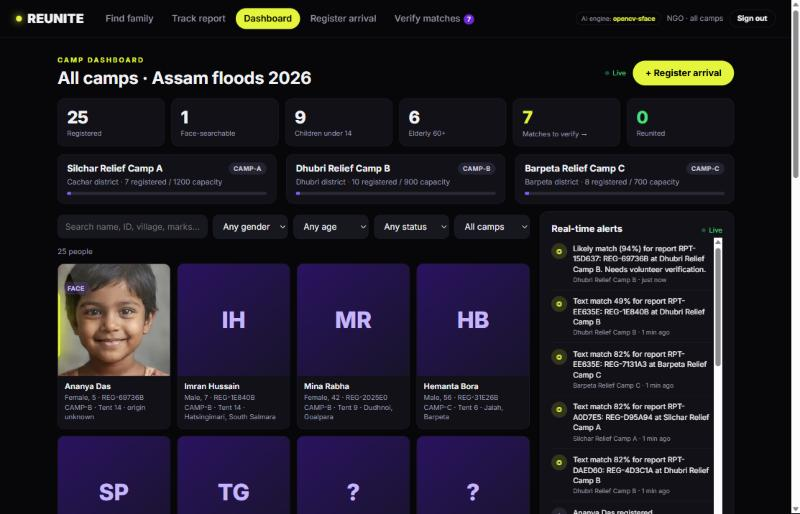
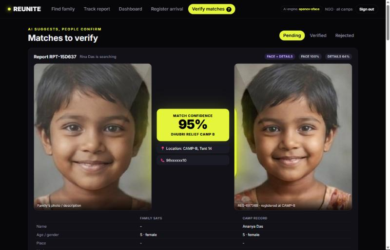
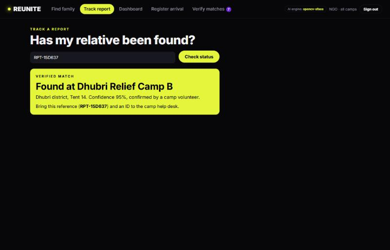

# REUNITE

**AI-powered disaster family reunification.** Helping families separated by floods find each other in minutes, not weeks.

Team **CodeCrystals** (Hira Irshad · Arshan Ali Khan) · CodeQuest National Tech Hackathon 2026 · Prototype round

---

## The problem

In floods (Kerala 2018, Assam 2026) evacuees go to whichever relief camp has room. Each camp keeps its own paper register, so a child registered at Camp A is invisible to a parent searching at Camp B. Families travel camp to camp for weeks.

## What the prototype does

One photo-matched registry shared by every relief camp.

| Feature | Where in the app |
|---|---|
| **Register at camp**: photo (upload or webcam), approx. age, gender, origin, tent, consent | Staff → *Register arrival* |
| **Family search with no login**: by photo, by description, or both | *Find family* |
| **Cross-camp face matching**: every search runs against all camps at once | `backend/face_engine.py` |
| **Text fallback search**: name, age, gender, last-seen place, identifying marks | `backend/matching.py` |
| **Confidence score on every match**, with face and detail sub-scores | Results and *Verify matches* |
| **Matching at intake**: family searches stay open; each new arrival is checked against them immediately | `POST /api/people` |
| **Human-in-the-loop**: AI suggests, a volunteer verifies before the family is told where the person is | Staff → *Verify matches* |
| **Camp dashboard**: searchable and filterable list (name, ID, village, marks, gender, age group, status, camp) with live stats | Staff → *Dashboard* |
| **Multi-camp registry and NGO view**: one database for 3 simulated Assam camps; the NGO login sees all of them | PIN `0000` |
| **Instant alerts**: real-time feed of intakes, likely matches and verifications | Dashboard sidebar |
| **Report tracking**: families check status with their report ID; the camp and tent are revealed only once verified | *Track report* |

### Trust and safety (built in)
- **Public search shows no photos or personal details.** Families see only the camp, approximate age, gender and confidence.
- Full photos and records are served **only to signed-in staff** (`/api/photos/*` requires a staff token).
- **Consent is mandatory**: the API rejects any registration without it.
- **Text-only matches are capped at 82%** so the system never claims false certainty without a face match; age or gender contradictions cap the score further.

## Screenshots

| Family search (public, no photos shown) | Camp dashboard (staff) |
|---|---|
|  |  |
| **Verify match: AI suggests, people confirm** | **Family tracking after verification** |
|  |  |

## Tech stack

| Layer | Used |
|---|---|
| Frontend | **React 18** (via `htm`, so there is no build step), plain CSS |
| Backend | **Flask** (Python) REST API |
| AI engine | **SFace** face recognition with the **YuNet** detector. It runs through **DeepFace** when `deepface` is installed, otherwise directly through **OpenCV** (same pre-trained SFace model, no TensorFlow). No training is needed. |
| Database | **SQLite** (records, embeddings and match history) |

```
reunite/
├── backend/
│   ├── app.py            Flask REST API and serves the frontend
│   ├── face_engine.py    DeepFace / OpenCV-SFace embeddings and confidence calibration
│   ├── matching.py       face and text scoring
│   ├── db.py             SQLite schema
│   ├── seed.py           3 simulated Assam camps, 25 people, 3 open family reports
│   ├── seed_photos/      optional face photos loaded by seed.py
│   └── models/           pre-trained ONNX models (YuNet + SFace)
├── frontend/             index.html, app.js (React), styles.css, demo/ sample photo
└── docs/
    └── screenshots/
```

## Run it locally

Requires Python 3.9+.

```bash
cd reunite
pip install -r requirements.txt
python backend/seed.py      # creates backend/data/reunite.db with demo data
python backend/app.py       # http://localhost:5000
```

If `backend/models/` is empty (for example on a fresh clone without the model files), download the two models:

```bash
curl -L -o backend/models/face_detection_yunet_2023mar.onnx https://github.com/opencv/opencv_zoo/raw/main/models/face_detection_yunet/face_detection_yunet_2023mar.onnx
curl -L -o backend/models/face_recognition_sface_2021dec.onnx https://github.com/opencv/opencv_zoo/raw/main/models/face_recognition_sface/face_recognition_sface_2021dec.onnx
```

Optional: `pip install deepface` makes the engine use DeepFace (SFace model) instead of calling OpenCV directly. The header shows which engine is active.

### Demo staff PINs (prototype only)

| PIN | Scope |
|---|---|
| `1111` | Silchar Relief Camp A (Cachar) |
| `2222` | Dhubri Relief Camp B (Dhubri) |
| `3333` | Barpeta Relief Camp C (Barpeta) |
| `0000` | NGO / district authority: all camps |

## Demo script: "Found in minutes, not weeks"

1. **Find family** (no login): click **Try the demo photo** (it loads `frontend/demo/family_photo_of_child.jpg` and fills in *Female*, age *5* and a sample contact). Click **Search every camp**.
   You get a likely match at **Dhubri Relief Camp B** with about **97% confidence**, and no photo or name is shown publicly. Note the report ID.
2. **Camp staff**: sign in with `0000`. The dashboard shows live stats, the camp registry and the alert you just triggered.
3. **Verify matches**: side-by-side comparison with **MATCH CONFIDENCE 97%, Dhubri Relief Camp B**, Tent 14, and face and detail sub-scores. Click **Verify & notify family**.
4. **Track report**: enter the report ID. The page now shows *Found at Dhubri Relief Camp B, Tent 14*.
5. **Matching at intake**: search by description only (for example *Bina Kalita, 10, female, Sarthebari, scar on forehead*). Then sign in with `3333` and register a matching arrival. The registration result reports the open family report it matched, and an alert fires.

To try real face matching, register yourself with one photo or webcam shot, then search with a *different* photo of yourself.

## API

| Method | Path | Auth | Purpose |
|---|---|---|---|
| GET | `/api/health` | none | active face engine |
| GET | `/api/camps` | none | camps and head counts |
| POST | `/api/search` | none | family search (multipart: `photo`, `name`, `age`, `gender`, `last_seen`, `marks`, `seeker_*`) |
| GET | `/api/reports/<ref>` | none | report status; location only once verified |
| POST | `/api/login` | none | `{pin}` → staff token |
| GET/POST | `/api/people` | staff | list with filters / register arrival (with intake matching) |
| GET | `/api/matches?status=` | staff | candidate matches |
| POST | `/api/matches/<id>/decision` | staff | `{decision: verified\|rejected}` |
| GET | `/api/alerts`, `/api/stats` | staff | live feed and dashboard numbers |
| GET | `/api/photos/<file>` | staff | full photos (staff only) |

## How the confidence score works

- **Face**: cosine similarity between SFace embeddings, mapped through a logistic curve centred on OpenCV's same-person threshold (0.363 → 50%, about 0.55 → 90%).
- **Details**: weighted agreement on gender, age (with tolerance), fuzzy name, last-seen place versus origin, and identifying marks, scaled down when few fields are available.
- **Combined**: 85% face + 15% details when both exist. A contradiction in age or gender caps the score at 60%.
- 70% and above is shown as a *likely match*; 45–70% as *possible*. Every match still needs a volunteer to verify it.

## Scope and next steps

The prototype runs on a small seeded dataset. Next steps:
- PostgreSQL with vector search (pgvector) for millions of records
- Offline-first camp app that syncs when connectivity returns
- SMS alerts for families without smartphones
- Proper staff identity and access control, and a formal security review
